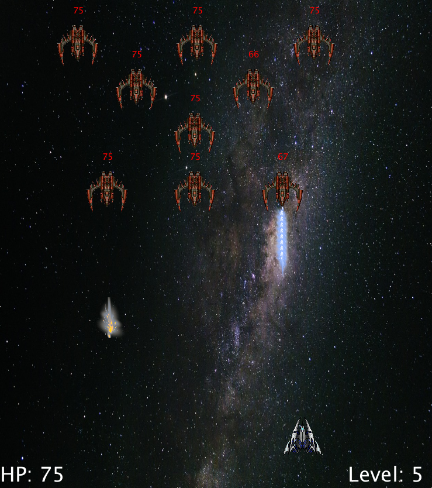
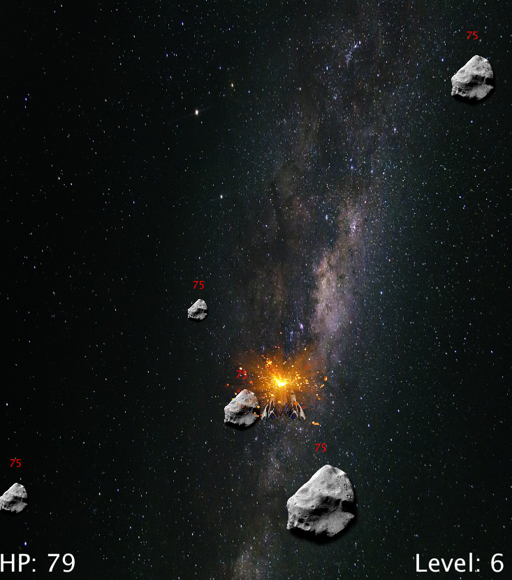
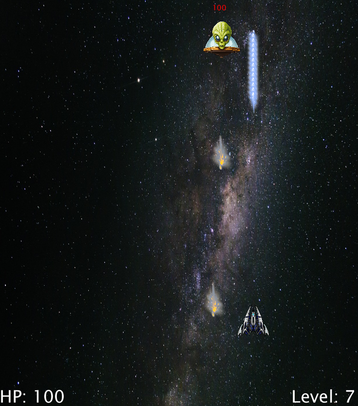

# 
SPACE MISERY

## 
Description

"Space Misery" is a 2D game inspired by "Chicken Invaders." In this game, the player takes control of a spaceship and must navigate through waves of various enemies, battling to survive. The player has the ability to both shoot at adversaries and evade incoming attacks.

The game consists of seven different levels, each progressively increasing in difficulty. The player's objective is to successfully navigate through these levels. Failure occurs if the player's spaceship makes physical contact with the invaders or if the player's spaceship's health points (HP) drop below zero.

As the player progresses and defeats a certain number of enemies, they are rewarded with power-ups that enhance their abilities. These power-ups include Double Damage, which increases the player's offensive capabilities, a healing power-up to restore health, and a Rebirth Rune. The Rebirth Rune allows the player to respawn and continue the current level even after being defeated.

The ultimate goal is to defeat "The ALIEN". Upon successfully overcoming this foe, the player achieves victory in the game.

---

## 
Backstory

This project was one of several projects I worked on during my university studies. The main goal was to understand and implement the Model-View-Controller (MVC) architectural pattern through a project of my choice.

I chose **Space Misery** because *Chicken Invaders* was one of my favorite games growing up. I had always wondered how a game like that was developed, so I decided to challenge myself by creating my own version while learning and applying the MVC pattern.

Every method is commented to make the codebase easy to follow (Also checkout Javadocs for more information). 

feel free to explore, experiment, and add new features!

---

## 
Levels and Enemies

### Levels 1, 2, 4, and 5 - Invaders (Laser Attacks)

### Levels 3 and 6 - Asteroid Rain (Collisions)

### Level 7 - Boss Fight (Rapid Laser Attacks)

---

## 
How to Play

To run "Space Misery" in IntelliJ IDEA or Visual Studio Code, open the project, navigate to the `Main` class in the `src` folder, and click the Run button in the top toolbar.

### 
Help

You can select levels by pressing the numbers from 1 to 7.The higher the level number, the harder the level gets. I recommend playing from level 1 and progressing to level 7. To access "Help and Controls", press `I` to display all the information you need to know about the game and its controls.

### 
Controls

You can control your player by pressing:

- `W` - Move up
- `A` - Move left
- `S` - Move down
- `D` - Move right
- `K` - Shoot

Have fun!

---

## 
Used Libraries and Sources

- [Processing](https://processing.org/)
- [JUnit 5](https://junit.org/junit5/)

### Images

- [Boss Image](https://www.cleanpng.com/png-hand-drawn-alien-mascot-alien-image-large-eyes-lon-7928518/)
- [Game Background Image](https://pixabay.com/photos/milky-way-nebula-space-stars-sky-1845068/)
- [Explosion Image](https://www.cleanpng.com/png-spot-light-effect-3117/download-png.html)
- [Player and Enemy Lasers](https://www.cleanpng.com/png-blue-beam-3104/)
- [Enemy Spaceship](https://www.cleanpng.com/png-spacecraft-sprite-2d-computer-graphics-clash-of-ta-4669364/)
- [Player Spaceship](https://www.cleanpng.com/png-spaceshiptwo-spacecraft-sprite-spaceshipone-portab-6712925/)